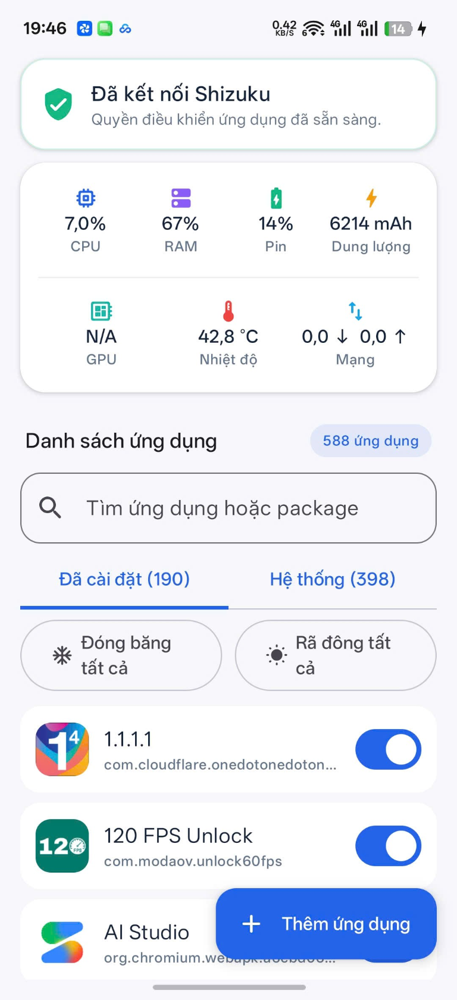
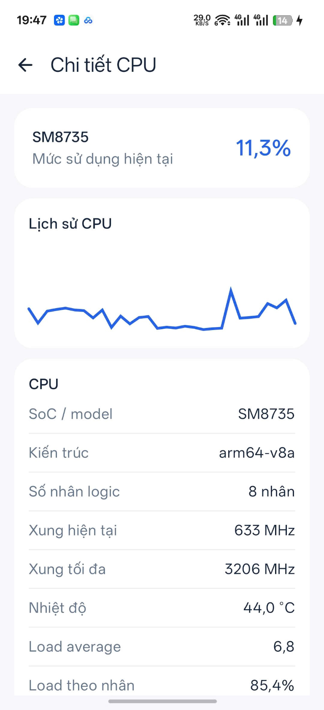
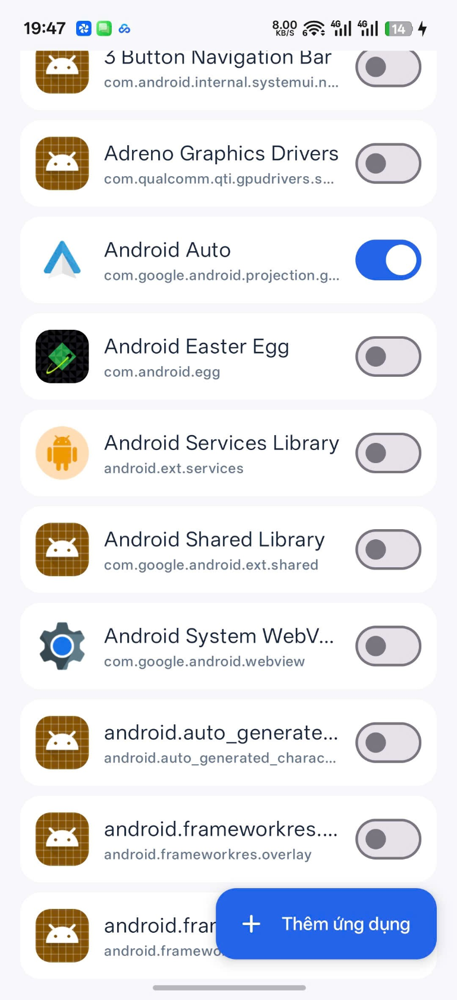

# 🧊 FrostGuard

<p align="center">
  <b>Quản lý ứng dụng Android gọn gàng hơn.</b><br>
  Đóng băng ứng dụng, theo dõi tài nguyên thiết bị và dọn bộ nhớ nền với Shizuku.
</p>

<p align="center">
  
  
  
  
</p>

FrostGuard là ứng dụng Android viết bằng **Kotlin** và **Jetpack Compose**. Ứng dụng dùng Shizuku để thao tác với các gói ứng dụng mà Android thường không cho phép ứng dụng thông thường điều khiển.

## ✨ Tính năng

- **Quản lý ứng dụng:** xem ứng dụng đã cài và ứng dụng hệ thống, tìm theo tên hoặc package.
- **Đóng băng / rã đông:** điều khiển từng ứng dụng hoặc hàng loạt; có thể force-stop ứng dụng sau khi đóng băng.
- **Theo dõi thiết bị:** xem CPU, RAM, pin, dung lượng, nhiệt độ và lưu lượng mạng; mở màn hình chi tiết phần cứng và lịch sử CPU.
- **Dọn bộ nhớ nền:** yêu cầu Shizuku force-stop các ứng dụng nền phù hợp.
- **Giao diện Compose:** Material 3, cập nhật số liệu định kỳ và hiển thị trạng thái kết nối Shizuku.

> Khả năng đọc một số chỉ số phần cứng phụ thuộc vào thiết bị và phiên bản Android. Giá trị có thể không khả dụng hoặc hiển thị `N/A`.

## 📱 Ảnh minh họa

<!-- Đặt ảnh đính kèm vào docs/screenshots/ với các tên bên dưới để hiển thị gallery. -->

| Tổng quan và danh sách ứng dụng | Chi tiết CPU |
|:--:|:--:|
|  |  |

| Danh sách ứng dụng hệ thống |
|:--:|
|  |

## 🚀 Cài đặt và chạy

### Yêu cầu

- Android **7.0 (API 24)** trở lên.
- Android Studio có hỗ trợ Android Gradle Plugin và Kotlin Compose compiler theo cấu hình dự án.
- Ứng dụng **Shizuku** đã cài trên thiết bị. Khởi động Shizuku trước khi sử dụng các chức năng điều khiển ứng dụng.

### Mở dự án

1. Clone repository và mở thư mục `android/` bằng Android Studio.
2. Chờ Gradle đồng bộ dependencies.
3. Chọn cấu hình chạy `app`, kết nối thiết bị Android rồi nhấn **Run**.
4. Mở FrostGuard, khởi chạy Shizuku và cấp quyền khi ứng dụng yêu cầu.

Có thể cài bản debug bằng Gradle từ thư mục `android/`:

```bash
./gradlew assembleDebug
```

Trên Windows, dùng `gradlew.bat assembleDebug`.

APK debug được tạo tại `android/app/build/outputs/apk/debug/app-debug.apk`.

## 🧰 Công nghệ

- Kotlin, Android SDK (compile SDK 36, min SDK 24)
- Jetpack Compose, Material 3
- Kotlin Coroutines
- Shizuku API và Shizuku Provider

## 🗂️ Cấu trúc chính

```text
android/
└── app/src/main/
    ├── kotlin/com/example/freezing_app/
    │   ├── MainActivity.kt        # Giao diện và luồng tương tác
    │   ├── FreezerRepository.kt   # Điều khiển ứng dụng qua Shizuku
    │   ├── ShizukuShell.kt        # Cầu nối lệnh shell
    │   └── DeviceStatsReader.kt   # Đọc số liệu thiết bị
    └── AndroidManifest.xml
```

## 🔐 Quyền Shizuku

FrostGuard cần Shizuku đang hoạt động và được cấp quyền để đóng băng, rã đông, force-stop ứng dụng hoặc dọn bộ nhớ. Nếu Shizuku chưa chạy, hãy khởi động dịch vụ rồi kết nối lại trong ứng dụng. Kết quả đọc thông số thiết bị có thể khác nhau tùy nhà sản xuất.

## 📄 Giấy phép

Repository hiện chưa khai báo giấy phép mã nguồn. Hãy bổ sung file `LICENSE` trước khi phân phối hoặc cho phép tái sử dụng mã nguồn.
